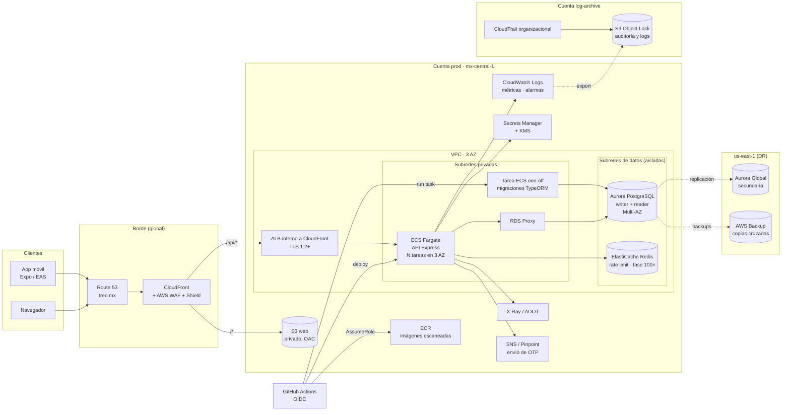

# Propuesta de despliegue en AWS (sin desplegar)

Este documento explica cómo llevaría la billetera (API Express + PostgreSQL, web React y app Expo) a producción en AWS para una empresa regulada del sector financiero. **No se desplegó nada**: es una propuesta escrita para la Fase 4 de la prueba (tarea T-30).

Los supuestos regulatorios (residencia de datos, plazos de retención) son una propuesta técnica que el área de cumplimiento debe validar.

## 1. Resumen de decisiones

| Tema | Decisión | Alternativas descartadas |
| --- | --- | --- |
| Cómputo de la API | **ECS Fargate** detrás de un ALB, en subredes privadas | App Runner, EKS, Lambda + API Gateway (ver §3) |
| Base de datos | **Aurora PostgreSQL** (compatible con 16), Multi-AZ, PITR de 35 días y Global Database para DR | RDS PostgreSQL Multi-AZ (opción válida, ver §4) |
| Web | **S3 + CloudFront** con OAC y WAF, mismo dominio que la API | Amplify Hosting |
| Móvil | **EAS Build/Submit** a App Store y Google Play; API por HTTPS en el mismo dominio | — |
| Observabilidad | CloudWatch (logs JSON, métricas, alarmas), OpenTelemetry → X-Ray, CloudTrail organizacional | — |
| CI/CD | **GitHub Actions** con OIDC, una cuenta AWS por ambiente (dev, staging, prod) | CodePipeline |
| Conexiones | Pool por tarea + **RDS Proxy** | Conexiones directas sin límite |
| IaC | **AWS CDK en TypeScript** | Terraform, SAM |

Región principal propuesta: **México (Central), `mx-central-1`**, para mantener los datos en el país. DR en `us-east-1`. Si cumplimiento no exige residencia local, ambas regiones pueden cambiar sin alterar el diseño.

## 2. Arquitectura

La web y la API comparten dominio (`treo.mx` y `treo.mx/api/*` vía CloudFront). Así la cookie del refresh token web sigue siendo `SameSite=Strict` y `Path=/api/v1/auth`, como en local con el proxy de Vite, sin abrir CORS con credenciales.

## 3. Cómputo de la API: ECS Fargate

**Por qué Fargate:**

- La API es un proceso Node de larga vida con un pool de conexiones a PostgreSQL. Las transferencias usan transacciones con `SELECT … FOR UPDATE` que pueden esperar bloqueos (`lock_timeout` de 5 s). Un contenedor persistente encaja mejor que funciones efímeras.
- No hay servidores que parchar, y escala por tareas con Application Auto Scaling (CPU, peticiones por destino del ALB).
- Da control de red completo: subredes privadas, security groups por tarea, VPC endpoints, sin IP pública.
- Es compatible con despliegues blue/green (CodeDeploy) y con tareas *one-off* para migraciones.

**Por qué descarto las otras opciones:**

| Servicio | Motivo |
| --- | --- |
| App Runner | Es más simple, pero da menos control de red y de despliegue (blue/green, tareas de migración, sidecars de observabilidad), y está menos difundido en entornos regulados. Sería válido para un MVP. |
| EKS | Kubernetes aporta flexibilidad que este sistema no necesita, a cambio de operar el plano de control, actualizaciones, add-ons y políticas. Para un servicio con una sola API el costo operativo no se justifica. |
| Lambda + API Gateway | Cada invocación concurrente abre su propia conexión, lo que provoca tormentas de conexiones contra PostgreSQL (mitigable con RDS Proxy, pero no eliminable). Suma arranques en frío en la ruta crítica de una transferencia, y el límite de 29 s de API Gateway convive mal con esperas de bloqueos y reintentos. Además, el rate limit en memoria y el pool dejarían de tener sentido. |

**Configuración:** al menos 3 tareas en prod (una por AZ), 0.5 vCPU y 1 GB cada una, escalado a 70 % de CPU. Health check en `/api/v1/health`. Tareas con sistema de archivos de solo lectura, usuario sin privilegios y la imagen escaneada en ECR (Inspector).

## 4. Base de datos: Aurora PostgreSQL

**Elección:** Aurora PostgreSQL (compatible con 16), con un writer y un reader en AZ distintas. El diseño actual se usa tal cual: triggers de saldo y de suma cero, `CHECK`, roles `treo_owner`/`treo_app`, funciones `SECURITY DEFINER` y la tabla de auditoría sin `UPDATE`/`DELETE`.

**Por qué Aurora y no RDS PostgreSQL:** el almacenamiento replica 6 copias en 3 AZ, la conmutación por error suele tardar menos de 30 s, y Global Database ofrece una réplica en otra región con RPO de segundos. RDS PostgreSQL Multi-AZ (clúster con dos standbys legibles) también cumpliría; lo elegiría si el costo pesa más que el RTO regional.

**Backups y recuperación:**

- Backups automáticos continuos con **PITR de 35 días**.
- AWS Backup con copias diarias a la región de DR y retención mensual de 1 año, en un vault con **Vault Lock** (no se pueden borrar ni acortar).
- Cifrado con KMS (llave administrada por el cliente), TLS obligatorio (`rds.force_ssl`).
- Simulacro trimestral de restauración a un punto en el tiempo, con el resultado medido y documentado.

**RPO y RTO objetivo:**

| Escenario | RPO | RTO |
| --- | --- | --- |
| Falla de una instancia o de una AZ | ≈ 0 (almacenamiento síncrono en 3 AZ) | < 2 min (failover automático + reconexión del pool) |
| Corrupción lógica (borrado o bug) | Al segundo, con PITR | < 1 h (restaurar a un clúster nuevo y redirigir) |
| Pérdida de la región | < 1 min (Global Database) | < 1 h (promover la secundaria y desplegar la API en DR con la misma IaC) |

**Credenciales:** `treo_app` (runtime) y `treo_owner` (solo migraciones) en Secrets Manager con rotación automática. La API nunca recibe la credencial del dueño del esquema.

## 5. Frontend web: S3 + CloudFront

- La build de Vite va a un bucket S3 privado, servido solo por CloudFront con Origin Access Control.
- CloudFront enruta `/api/*` al ALB (sin caché, reenviando `Authorization`, cookies y `Idempotency-Key`) y `/*` al bucket (caché larga para assets con hash y corta para `index.html`).
- AWS WAF con reglas administradas (OWASP común, IPs maliciosas), rate limit por IP en `/api/v1/auth/*` y Shield Standard.
- Encabezados de seguridad con una *response headers policy*: CSP estricta, HSTS, `X-Content-Type-Options`, `Referrer-Policy` y `frame-ancestors 'none'`.
- Descarto Amplify Hosting: es cómodo, pero con S3 + CloudFront el ruteo del mismo dominio hacia la API, el WAF y la IaC quedan bajo el mismo control que el resto.

## 6. App móvil: distribución y conexión segura

**Distribución:**

- **EAS Build** genera los binarios firmados por ambiente (perfiles `development`, `staging`, `production`), cada uno con su `EXPO_PUBLIC_API_URL`.
- **EAS Submit** los publica en App Store Connect (TestFlight para staging) y Google Play (pistas interna, beta y producción).
- **EAS Update** para correcciones de JavaScript, con canales por ambiente y *code signing* de las actualizaciones. Las reglas financieras viven en el servidor, así que una actualización OTA no puede cambiar cómo se mueve el dinero.

**Conexión segura:**

- Solo HTTPS (TLS 1.2+) a `https://treo.mx/api/v1`. ATS en iOS y `cleartextTrafficPermitted=false` en Android para builds de producción (el HTTP de desarrollo solo existe en Expo Go).
- Tokens solo en `expo-secure-store` (Keychain/Keystore), como ya implementa la app.
- El mismo WAF de CloudFront protege a la app.
- Evoluciones:
  - Certificate pinning con llaves de respaldo, evaluando el riesgo de dejar apps sin servicio si se rota mal.
  - App Attest (iOS) y Play Integrity (Android) para validar que las peticiones vienen de la app legítima.
  - Desbloqueo biométrico.

## 7. Observabilidad y auditoría

**Logs de aplicación:**

- La API ya escribe JSON con `request_id` y datos sensibles enmascarados (pino). En ECS van a CloudWatch Logs con el driver `awslogs` (o FireLens).
- Retención: 90 días en CloudWatch y exportación a S3 en la cuenta *log-archive*, con transición a Glacier y retención total de 1 año.

**Métricas y alarmas** (CloudWatch, avisos por SNS a guardia):

- 5xx del ALB, latencia p99 de `POST /transfers` y transferencias rechazadas por código.
- Tasa de `503 TRY_AGAIN` (bloqueos y deadlocks), logins fallidos y `REFRESH_TOKEN_REUSED`, como señal de robo de sesión.
- Conexiones de Aurora y del Proxy, lag del reader y espacio libre.

**Trazas:** OpenTelemetry con el colector ADOT como sidecar y envío a X-Ray, para ver API → Proxy → Aurora por petición.

**Conciliación:** una tarea programada (EventBridge Scheduler → ECS) verifica a diario que el saldo de cada cuenta sea igual a la suma de sus asientos, y que los asientos de cada transferencia sumen cero. Si algo diverge, abre un incidente. Hoy la base lo impide y las pruebas lo verifican; la conciliación detectaría cualquier camino no previsto.

**Auditoría:**

- **CloudTrail organizacional** (todas las cuentas y regiones, eventos de datos de S3 y KMS) hacia un bucket con **S3 Object Lock en modo compliance**, en la cuenta *log-archive*, a la que solo accede seguridad.
- **Tabla `audit_log`** (solo inserción, protegida por permisos en la base): vive en Aurora. Una exportación diaria la copia a S3 con Object Lock.
- **Retención propuesta: 10 años** para la auditoría de operaciones y CloudTrail, alineada con la conservación de registros mercantiles (Código de Comercio, art. 49), sujeta a validación de cumplimiento (CNBV/Banxico según la figura regulatoria). En Aurora se conservan 13 meses en línea; lo anterior se consulta en S3 con Athena.
- **Controles adicionales:** GuardDuty, Security Hub (CIS y AWS FSBP), AWS Config con reglas de conformidad y IAM Access Analyzer.

## 8. CI/CD con GitHub Actions y OIDC

El repositorio ya tiene `.github/workflows/ci.yml` (lint, TypeScript y pruebas de api, web, shared y móvil, con PostgreSQL 16 de servicio). El despliegue lo extendería así:

- **Cuentas:** AWS Organizations con una cuenta por ambiente (`dev`, `staging`, `prod`), además de *log-archive* y *security*. Los SCP impiden desactivar CloudTrail o salir de las regiones permitidas.
- **Autenticación:** GitHub OIDC → `sts:AssumeRoleWithWebIdentity`. El rol de cada cuenta confía solo en `repo:DavidCacha/treo-wallet-challenge-test:environment:<ambiente>`. Sin llaves de acceso de larga duración, con permisos mínimos (ECR push, `ecs:UpdateService`, `ecs:RunTask` de la migración, `s3:PutObject` en el bucket web, invalidación de CloudFront).
- **Flujo:**
  1. Un PR corre CI. El merge a `main` construye la imagen una vez, la etiqueta con el SHA y la escanea.
  2. Se despliega a **dev** de forma automática.
  3. Se promueve la misma imagen a **staging**, con pruebas de humo y E2E.
  4. **prod** requiere aprobación manual (GitHub Environments con revisores obligatorios) y despliegue blue/green con rollback automático por alarmas.
- **Migraciones:** corren como tarea ECS *one-off* con la credencial de `treo_owner`, antes de cambiar el tráfico. Se escriben compatibles hacia atrás (*expand → migrate → contract*) para que la versión anterior siga funcionando durante el despliegue.
- **Web:** `aws s3 sync` de la build e invalidación de `index.html`. **Móvil:** `eas build` y `eas submit` desde un workflow con el token de Expo en GitHub Secrets del ambiente.

## 9. Conexiones a PostgreSQL al escalar horizontalmente

- Cada tarea tiene un pool acotado (`DB_POOL_MAX`, hoy 20). Regla: `tareas_máximas × DB_POOL_MAX` debe quedar por debajo del límite que admite el Proxy hacia Aurora, con margen para migraciones y administración.
- **RDS Proxy** entre ECS y Aurora:
  - Multiplexa conexiones y absorbe picos de escalado.
  - Mantiene las conexiones durante el failover, que baja de decenas de segundos a unos pocos.
  - Autentica con IAM o Secrets Manager.
- Las transacciones de transferencia (`BEGIN … FOR UPDATE … COMMIT`) funcionan con el Proxy, porque una transacción siempre usa la misma conexión.
- La API hace `SET LOCAL lock_timeout` dentro de cada transacción. Antes de producción hay que verificar en staging, con la métrica `DatabaseConnectionsCurrentlySessionPinned`, que no fije sesiones (*pinning*). Si lo hace, el valor se mueve a la configuración del rol (`ALTER ROLE treo_app SET lock_timeout = '5s'`).
- Las lecturas pesadas (historial, estado de cuenta) pueden ir al endpoint *reader* de Aurora. Las lecturas que deciden dinero (saldo para transferir, límite diario) siempre van al writer, dentro de la transacción.

## 10. Si el volumen crece 100 veces

Primero lo que hoy limita, en orden de impacto:

1. **Rate limit en memoria:** con varias tareas cada una cuenta por separado. Se mueve a **ElastiCache Redis** (contadores con TTL) además de WAF. Es lo primero que cambiaría, incluso antes del 100×.
2. **Cuentas calientes:** las transferencias de una misma cuenta se serializan por diseño (`FOR UPDATE`). Para un usuario normal es correcto. Una cuenta con miles de operaciones por segundo (comercio o tesorería) se reparte en **sub-cuentas** que se concilian periódicamente, y las acreditaciones masivas pasan a procesarse en lotes.
3. **Historial:**
   - **Particionar `ledger_entries` por mes** (particionado declarativo).
   - El índice de historial ya hace que la página no dependa del tamaño; las particiones mantienen el vacuum y los índices manejables.
   - Las particiones viejas pasan a almacenamiento de menor costo y se exportan a S3/Athena para analítica.
4. **Base de datos:**
   - Escalar verticalmente el writer y usar Aurora I/O-Optimized si el I/O domina el costo.
   - Llevar las lecturas al reader.
   - Si el writer único no alcanza, particionar por usuario (Citus, o varios clústeres con un enrutador), cuidando que las transferencias entre particiones requieran un protocolo de dos fases o una cuenta puente con *outbox*.
5. **Trabajo asíncrono:** patrón *outbox* (tabla en la misma transacción + SQS) para notificaciones, envío de OTP por SNS/Pinpoint, webhooks y exportaciones, sin tocar la ruta crítica de la transferencia.
6. **API:** más tareas Fargate (sin estado), escalado por peticiones, y caché en CloudFront para respuestas públicas (no aplica a datos de cuenta).
7. **Operación:** pruebas de carga en staging antes de cada salto de capacidad (k6 o Artillery), con SLO definidos (por ejemplo, p99 de transferencia < 300 ms y disponibilidad de 99.95 %).

## 11. Infraestructura como código: AWS CDK (TypeScript)

- Se usa el mismo lenguaje que el resto del monorepo (tipos, revisión de código y pruebas con Jest o Vitest), con constructos L2 maduros para ECS, Aurora, CloudFront y WAF, y `cdk-nag` para validar reglas de seguridad (AWS Solutions, HIPAA o NIST) en CI.
- Estructura propuesta: un `app` con stacks por capa (`network`, `data`, `api`, `web`, `observability`) y ambientes parametrizados. `cdk diff` en el PR y `cdk deploy` desde GitHub Actions con OIDC.
- Terraform sería igual de válido, sobre todo si la organización ya lo usa con varios proveedores. SAM queda descartado porque está orientado a Lambda.

## 12. Autenticación: evolución con Amazon Cognito

Hoy la API emite sus propios JWT (acceso de 15 min, refresh rotativo con detección de reutilización, argon2 y rate limit). Integrar Cognito era opcional en la prueba y no se implementó. En producción lo evaluaría porque aporta:

- MFA (TOTP o SMS) y recuperación de cuenta gestionadas.
- Protección contra credenciales comprometidas (*advanced security*).
- Validación de tokens por JWKS.
- Federación con identidades corporativas para el personal.

La migración mantendría el contrato de la API: el middleware validaría los JWT de Cognito con su JWKS en lugar de la llave propia, y el refresh pasaría a gestionarlo Cognito. El OTP de transferencias sigue siendo de la API, porque autoriza una operación, no un inicio de sesión.
