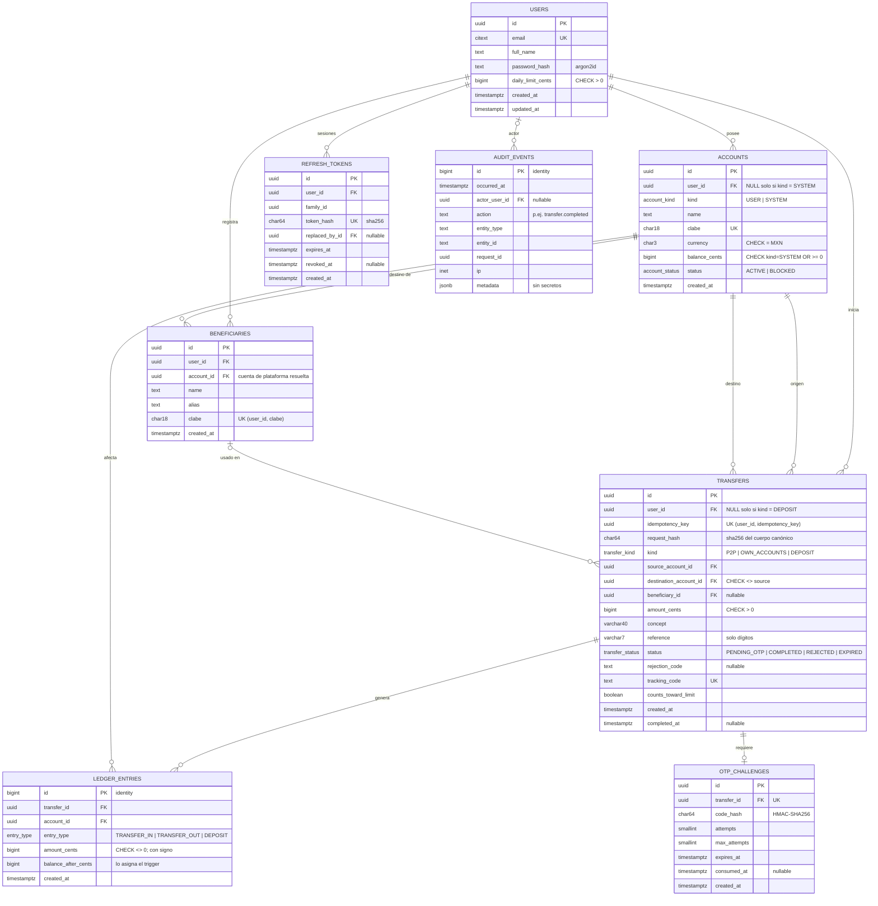
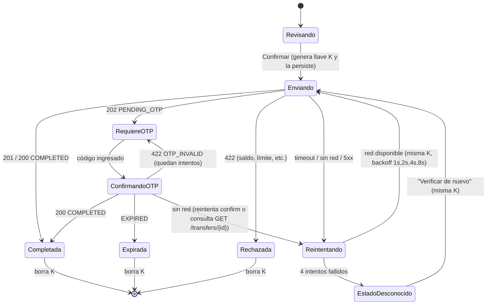
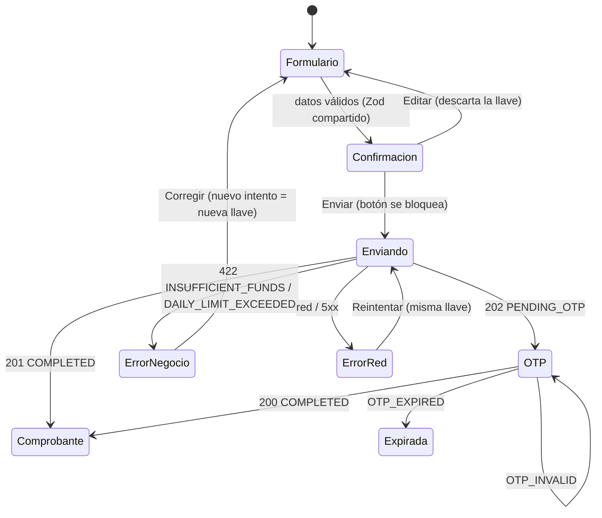

# Diseño — Billetera digital MXN (Treo)

> Estado: **borrador para revisión** · Fase 1 (SPEC).
> Requerimientos: [`requirements.md`](./requirements.md) · Tareas: [`tasks.md`](./tasks.md)

## 1. Decisiones clave (resumen)

| # | Decisión | Motivo | Req. |
| --- | --- | --- | --- |
| D-1 | Dinero en `BIGINT` centavos en DB y `integer` en la API; en TypeScript `number` validado con `Number.isSafeInteger`. | Exactitud sin `float`; `2^53` centavos ≫ cualquier saldo posible. Evita `BigInt` en JSON. | NFR-2 |
| D-2 | Contabilidad de **partida doble**: cada transferencia genera asientos que suman cero; el saldo de la cuenta lo actualiza un **trigger** al insertar cada asiento. | Una sola fuente de verdad (el libro), y la base impide saldos negativos y asientos desbalanceados aunque el código falle. | R4.7, R4.8, NFR-1 |
| D-3 | Concurrencia con `READ COMMITTED` + `SELECT … FOR UPDATE` en orden determinista (usuario → cuentas por `id`). | Comportamiento predecible con cuentas "calientes"; sin tormentas de reintentos. Ver §5.2. | R4.12, NFR-3 |
| D-4 | Idempotencia guardada en la propia tabla `transfers` con `UNIQUE (user_id, idempotency_key)` + hash del cuerpo. | Mismo registro = misma transacción que el movimiento de dinero; no puede quedar desincronizada. | R4.9, R4.10 |
| D-5 | JWT de acceso 15 min + refresh token opaco rotativo con detección de reutilización por familia. | Requerido por la prueba; revocable; limita el daño de un token robado. | R1.4–R1.9 |
| D-6 | Monorepo npm workspaces: `/api`, `/web`, `/mobile`, `/packages/shared`; el contrato OpenAPI vive en `packages/shared/openapi.yaml` y genera los tipos. | Tipos y validaciones compartidas (CLABE, montos) entre los tres proyectos. | R3.7, NFR-7 |
| D-7 | Arquitectura por módulos de dominio con capas internas (routes → controller → service → repository). | Sencilla y mantenible; la lógica financiera queda en servicios probables sin HTTP. | NFR-8 |

## 2. Arquitectura y estructura

```
/api
  src/
    config/            # env validado con Zod
    http/              # app Express, middlewares (requestId, auth, errors, rateLimit)
    modules/
      auth/            # routes, controller, service, schemas
      accounts/
      beneficiaries/
      transfers/       # TransferService (dominio), LimitService, OtpService
      movements/
      audit/           # AuditService (solo inserción)
    db/
      data-source.ts   # TypeORM, synchronize: false
      entities/
      migrations/
      seed/
    lib/               # logger (pino), problem (RFC 7807), masking, clock
  test/unit | test/integration | test/concurrency
/web                   # Vite + React 18 + TanStack Query + React Hook Form + Zod
/mobile                # Expo + TypeScript + TanStack Query + expo-secure-store
/packages/shared
  openapi.yaml         # contrato fuente (copiado de §7)
  src/generated/       # tipos generados con openapi-typescript
  src/clabe.ts         # validación de CLABE
  src/money.ts         # parseo/formato de centavos sin float
  src/schemas.ts       # esquemas Zod compartidos (formularios y API)
/docs/aws-deploy.md    # Fase 4
docker-compose.yml     # PostgreSQL 16
```

Flujo de una petición: `requestId` → `pino-http` → `helmet`/`cors` → `express.json({ limit: '10kb' })` → `rateLimit` (auth) → `authenticate` (JWT) → `validate(zodSchema)` → controller → **service (transacción)** → repository → `problemHandler`.

Stack: Node.js 20 LTS, Express 4, TypeScript `strict`, TypeORM 0.3, PostgreSQL 16, Zod, pino, argon2, jsonwebtoken, express-rate-limit, swagger-ui-express, Vitest + Supertest (API), Vitest + Testing Library + MSW (web), Jest-expo + Testing Library (mobile).

## 3. Modelo de datos

### 3.1 Diagrama ER



### 3.2 Restricciones e invariantes en la base (no solo en código)

| Invariante | Mecanismo | Req. |
| --- | --- | --- |
| Saldo de cuentas de usuario ≥ 0 | `CHECK (kind = 'SYSTEM' OR balance_cents >= 0)` en `accounts`. La cuenta `SYSTEM` (tesorería del seed) puede ser negativa: representa el dinero que "entró" a la plataforma. | R4.8 |
| Coherencia usuario/cuenta de sistema | `CHECK ((kind = 'SYSTEM') = (user_id IS NULL))` | NFR-1 |
| Moneda única | `CHECK (currency = 'MXN')` | — |
| CLABE con formato | `CHECK (clabe ~ '^[0-9]{18}$')` en `accounts` y `beneficiaries` (el dígito verificador se valida en la capa de dominio compartida) | R3.1 |
| Monto positivo, sin autotransferencia | `CHECK (amount_cents > 0)`, `CHECK (source_account_id <> destination_account_id)` | R4.3, R4.6 |
| Referencia numérica | `CHECK (reference ~ '^[0-9]{1,7}$')`, `CHECK (char_length(concept) BETWEEN 1 AND 40)` | R4.4 |
| Idempotencia | `UNIQUE (user_id, idempotency_key)` | R4.9 |
| Beneficiario único por usuario | `UNIQUE (user_id, clabe)` | R3.5 |
| Un OTP por transferencia | `UNIQUE (transfer_id)` en `otp_challenges` | R6.5 |
| Asientos suman cero por transferencia | `CONSTRAINT TRIGGER trg_ledger_balanced AFTER INSERT ON ledger_entries DEFERRABLE INITIALLY DEFERRED`: al `COMMIT` verifica `SUM(amount_cents) = 0` y `COUNT(*) >= 2` para el `transfer_id`. Un segundo constraint trigger diferido sobre `transfers` verifica que toda transferencia `COMPLETED` tenga asientos balanceados y que las no completadas no tengan asientos. | R4.7 |
| Saldo = suma de asientos | `BEFORE INSERT` en `ledger_entries` ejecuta `UPDATE accounts SET balance_cents = balance_cents + NEW.amount_cents WHERE id = NEW.account_id RETURNING balance_cents INTO NEW.balance_after_cents`. Si el `CHECK` de saldo falla, la transacción completa se revierte. El rol de la app **no** tiene `UPDATE` sobre `accounts.balance_cents` (grants por columna); la función es `SECURITY DEFINER` con `search_path` fijo. | R2.2, R4.8 |
| Libro y auditoría inmutables | `REVOKE UPDATE, DELETE, TRUNCATE ON ledger_entries, audit_events FROM treo_app` + triggers `BEFORE UPDATE OR DELETE` y `BEFORE TRUNCATE` que lanzan excepción (defensa aun para roles con más privilegios). | NFR-4 |

Roles de base de datos:
- `treo_owner`: dueño del esquema; corre migraciones; dueño de funciones `SECURITY DEFINER`.
- `treo_app`: rol de la API en tiempo de ejecución. `SELECT, INSERT` en todas las tablas de negocio; `UPDATE` solo en columnas explícitas (`transfers.status, rejection_code, completed_at, counts_toward_limit`, `otp_challenges.attempts, consumed_at`, `refresh_tokens.revoked_at, replaced_by_id`, `accounts.name, status`, `users.full_name, updated_at`); sin `DELETE` salvo en `beneficiaries` (no expuesto aún); nada sobre `audit_events` excepto `INSERT`.

### 3.3 Índices

| Índice | Uso |
| --- | --- |
| `ledger_entries (account_id, created_at DESC, id DESC) INCLUDE (entry_type, amount_cents, balance_after_cents)` | Historial con paginación por cursor (keyset) y filtro de fecha; `entry_type` se evalúa dentro del índice. |
| `ledger_entries (transfer_id)` | Comprobante y verificación de cuadre. |
| `transfers (user_id, completed_at) WHERE status = 'COMPLETED' AND counts_toward_limit` | Suma del límite diario. |
| `transfers (user_id, idempotency_key)` UNIQUE | Idempotencia. |
| `accounts (user_id)`, `beneficiaries (user_id)`, `refresh_tokens (family_id)`, `audit_events (actor_user_id, occurred_at)` | Consultas de propiedad y auditoría. |

### 3.4 Dónde TypeORM no alcanza

TypeORM se usa para entidades, repositorios, transacciones (`dataSource.transaction('READ COMMITTED', …)`) y bloqueos (`setLock('pessimistic_write')` → `FOR UPDATE`). Lo siguiente se escribe como **SQL crudo dentro de migraciones TypeORM** (`queryRunner.query(...)`), porque los decoradores no lo soportan:

- Constraint triggers diferidos (cuadre de asientos), trigger de aplicación de saldo, triggers de inmutabilidad.
- Roles, `GRANT`/`REVOKE` por tabla y por columna.
- Índices con `INCLUDE`, parciales y con orden `DESC` explícito.
- Extensión `citext` y tipos `ENUM` nombrados.
- `SET LOCAL lock_timeout` / `statement_timeout` por transacción.
- `BIGINT` llega de `pg` como `string`: se usa un `ValueTransformer` que convierte a `number` y lanza error si no es `Number.isSafeInteger`.

## 4. Reglas de dominio compartidas (`packages/shared`)

**CLABE** (`isValidClabe(clabe: string): boolean`): 18 dígitos (`/^\d{18}$/`); pesos `[3,7,1]` cíclicos sobre los primeros 17; `suma = Σ ((dᵢ·wᵢ) mod 10)`; `dv = (10 − (suma mod 10)) mod 10`; válida si `dv === d₁₈`. Las cuentas internas se generan con un prefijo de banco/plaza configurable + 11 dígitos de cuenta + dígito verificador.

**Montos** (`parseMxnToCents(input: string): Result<number>`): acepta `"1234"`, `"1,234.5"`, `"1234.56"`; quita separadores de miles, divide por `.` como cadena, rechaza más de 2 decimales, signos, notación científica o valores fuera de rango; construye centavos con aritmética de enteros sobre las partes. **Nunca** `parseFloat`.
`formatCents(cents: number): string`: arma la cadena decimal exacta `"<entero>.<dd>"` y la pasa a `Intl.NumberFormat('es-MX', { style: 'currency', currency: 'MXN' }).format(decimalString)` (Intl.NumberFormat v3 acepta cadenas decimales exactas). Si el motor no lo soporta (verificar en Hermes durante T-25), formatea la parte entera con `Intl.NumberFormat` y concatena los centavos.

**Esquemas Zod**: `createTransferSchema`, `createBeneficiarySchema`, `registerSchema`, `loginSchema`, `movementsQuerySchema`. Los formularios web/móvil usan las mismas reglas que la API.

## 5. Transferencias: concurrencia, idempotencia, límite y OTP

### 5.1 Algoritmo de `POST /transfers`

```text
validar esquema (Zod) e Idempotency-Key (UUID)            → 400 si falla
hash = sha256(JSON canónico {source_account_id, destination, amount_cents, concept, reference})

BEGIN (READ COMMITTED); SET LOCAL lock_timeout = '5s';
 1. SELECT id FROM users WHERE id = :userId FOR UPDATE
      -- serializa las transferencias salientes del usuario: idempotencia y límite diario sin carreras
 2. SELECT * FROM transfers WHERE user_id = :userId AND idempotency_key = :key
      si existe: hash distinto → 422 IDEMPOTENCY_KEY_REUSED
                 hash igual  → ROLLBACK y repetir la respuesta original (Idempotent-Replayed: true)
 3. resolver destino:
      beneficiary_id → beneficiario propio → account_id     (404 si no es del usuario)
      destination_account_id → cuenta propia                 (404 si no es del usuario)
      kind = OWN_ACCOUNTS si destino es propio, si no P2P
 4. SELECT … FROM accounts WHERE id IN (:src, :dst) ORDER BY id FOR UPDATE
      -- orden determinista por UUID → sin ciclos de espera
 5. validar: origen propio y ACTIVE, destino ACTIVE, src ≠ dst (SAME_ACCOUNT_TRANSFER)
             saldo_origen ≥ monto (INSUFFICIENT_FUNDS)
             si P2P: usado_hoy + monto ≤ daily_limit_cents (DAILY_LIMIT_EXCEEDED)
 6a. rechazo de negocio → INSERT transfers(status = REJECTED, rejection_code); audit; COMMIT → 422
 6b. P2P y monto > OTP_THRESHOLD_CENTS → INSERT transfers(PENDING_OTP) + otp_challenges; audit; COMMIT → 202
 6c. si no → INSERT transfers(COMPLETED, completed_at = now())
             INSERT ledger_entries (src, TRANSFER_OUT, -monto), (dst, TRANSFER_IN, +monto)
             -- trigger aplica saldos; CHECK impide negativos; trigger diferido verifica Σ = 0
             audit; COMMIT → 201 con comprobante
EXCEPCIONES:
  23505 sobre (user_id, idempotency_key) → releer y repetir respuesta (red de seguridad)
  23514 (CHECK de saldo)                 → 422 INSUFFICIENT_FUNDS (red de seguridad)
  40P01 / 55P03 (deadlock / lock timeout) → reintentar hasta 3 veces con backoff; luego 503
```

`transfers.counts_toward_limit = (kind = 'P2P')`. El comprobante se reconstruye siempre desde la fila de `transfers` + asientos, así la respuesta repetida por idempotencia es idéntica a la original.

### 5.2 ¿Por qué `FOR UPDATE` y no `SERIALIZABLE`?

- **Cuenta caliente:** la prueba exige 100 transferencias simultáneas desde una sola cuenta. Con `SERIALIZABLE` casi todas abortarían con `40001` y tendrían que reintentarse en bucle (latencia impredecible, pruebas inestables). Con `FOR UPDATE` esperan en fila y cada una ve el saldo ya actualizado.
- **Control explícito:** el bloqueo muestra en el código qué filas protegen qué invariante; con TypeORM es directo (`setLock('pessimistic_write')`).
- **Deadlocks evitados por diseño:** cada transacción bloquea primero **solo** la fila de su propio usuario y después las cuentas en orden ascendente de `id`. Ninguna transacción bloquea la fila de usuario de otra persona, y todas toman las cuentas en el mismo orden, así que no hay ciclos (A→B y B→A piden `min(id)` primero).
- **Costo aceptado:** las transferencias de una misma cuenta se serializan. Para una billetera es correcto; la estrategia a 100× se discute en `/docs/aws-deploy.md`.
- La integridad no depende solo del bloqueo: los `CHECK` y triggers (§3.2) siguen siendo la última línea de defensa.

### 5.3 Idempotencia

- Encabezado `Idempotency-Key` obligatorio (UUID v4) en `POST /transfers`. Alcance: por usuario. Retención: indefinida (vive en `transfers`).
- Misma llave + mismo hash → mismo código HTTP y mismo cuerpo, con `Idempotent-Replayed: true`. Incluye rechazos (`422`) y pendientes de OTP (`202`, mismo `challenge`; el código no se reenvía).
- Misma llave + distinto hash → `422 IDEMPOTENCY_KEY_REUSED`.
- Peticiones concurrentes con la misma llave: el bloqueo del paso 1 las serializa; la segunda encuentra la fila en el paso 2. El `UNIQUE` cubre cualquier camino que no pase por ese bloqueo.
- Errores de validación (`400`) y de autenticación no consumen la llave.
- Clientes: web genera la llave al entrar a la pantalla de confirmación y la conserva hasta un resultado definitivo; móvil la persiste junto con el cuerpo en `expo-secure-store` hasta conocer el resultado (sobrevive a cierre de la app).
- `POST /transfers/{id}/confirm` es idempotente por estado: si ya está `COMPLETED`, devuelve `200` con el estado actual sin re-ejecutar.

### 5.4 Pérdida de red en móvil

Máquina de estados del envío (cliente):



La app escucha `@react-native-community/netinfo` para reanudar al recuperar red. Nunca muestra éxito o fallo sin respuesta del servidor; en `EstadoDesconocido` muestra "No pudimos confirmar el estado" y no permite iniciar otra transferencia con los mismos datos hasta resolverla.

### 5.5 Límite diario

- `usado_hoy = SUM(amount_cents) FROM transfers WHERE user_id = :u AND status = 'COMPLETED' AND counts_toward_limit AND completed_at >= :inicio AND completed_at < :fin`.
- `:inicio`/`:fin` se calculan **en SQL** a partir del mismo `now()` de la transacción que se guardará como `completed_at`: `date_trunc('day', now() AT TIME ZONE :tz) AT TIME ZONE :tz` y `+ interval '1 day'`. Así el día del límite y la fecha registrada nunca difieren, aunque la transacción espere un bloqueo al cruzar la medianoche.
- Zona IANA `America/Mexico_City` (no offset fijo).
- Se valida al crear (para no pedir OTP inútilmente) y de nuevo al confirmar el OTP (R6.4).
- El bloqueo de la fila del usuario (paso 1) evita que dos transferencias simultáneas lean el mismo `usado_hoy`.

### 5.6 Código de un solo uso (OTP)

- 6 dígitos con `crypto.randomInt`; se guarda `HMAC-SHA256(OTP_PEPPER, transfer_id || code)`; comparación en tiempo constante.
- Vigencia 5 min, 3 intentos. Entrega simulada: log `info` con `otp.dev_code` solo en desarrollo, y `dev_otp_code` en la respuesta si `NODE_ENV=development`. En otros entornos el campo no existe.
- `POST /transfers/{id}/confirm`: `BEGIN` → `FOR UPDATE` usuario → `FOR UPDATE` transferencia y su challenge → validar estado, expiración, intentos, código → bloquear cuentas en orden → revalidar saldo y límite → asientos → `consumed_at = now()`, `status = COMPLETED` → `COMMIT`.
- Fallo de código: se incrementa `attempts` y se hace `COMMIT` (el intento cuenta aunque se responda error). Al llegar a `max_attempts` o al expirar, `status = EXPIRED`.
- Si al confirmar ya no hay saldo o límite, la transferencia pasa a `REJECTED` con el código correspondiente.

## 6. Autenticación y protección de datos

| Tema | Diseño |
| --- | --- |
| Contraseñas | argon2id (`memoryCost` 19 MiB, `timeCost` 2, `parallelism` 1, parámetros OWASP). Login con correo inexistente verifica contra un hash ficticio para igualar tiempos. |
| Access token | JWT HS256, 15 min, claims `sub`, `iat`, `exp`, `iss`, `aud`, `jti`. Secreto ≥ 32 bytes desde env. Se envía en `Authorization: Bearer`. |
| Refresh token | 32 bytes aleatorios (base64url), se guarda solo `sha256`. Cada uso: `FOR UPDATE` de la fila, se revoca y se emite uno nuevo en la misma familia (`replaced_by_id`). Presentar uno revocado → revocar toda la familia + `audit: auth.refresh_reuse_detected`. |
| Transporte por cliente | Encabezado `X-Client-Platform: web | mobile` en login/refresh. **Web:** refresh en cookie `refresh_token` `HttpOnly; Secure; SameSite=Strict; Path=/api/v1/auth`, nunca en el cuerpo; access token solo en memoria; al recargar la página se llama a `/auth/refresh`. **Móvil:** refresh en el cuerpo, guardado en `expo-secure-store`. |
| CSRF | La cookie solo viaja a `/api/v1/auth/*` y es `SameSite=Strict`; además `/auth/refresh` y `/auth/logout` exigen el encabezado personalizado `X-Client-Platform` (no enviable cross-site sin preflight CORS). |
| Refresh concurrente | El cliente web hace *single-flight* (una sola renovación en curso) para no disparar la detección de reutilización por error. |
| Rate limiting | Login: 5 intentos / 15 min por `ip + email` (`express-rate-limit`, almacén en memoria en local; Redis/WAF en producción). `/auth/*` en general: 30 / min por IP. |
| Autorización | Todo recurso se filtra por `user_id` del token en el repositorio. Recurso ajeno → `404`. |
| Encabezados | `helmet`, CORS con lista de orígenes permitidos y `credentials: true` solo para el origen web; límite de cuerpo 10 KB. |
| Datos sensibles | No se registran contraseñas, tokens, OTP ni `Authorization`. CLABE enmascarada en logs y en datos de contraparte (`************1234`). La auditoría guarda metadatos mínimos, nunca secretos. |
| Móvil | Tokens solo en `expo-secure-store`; pantalla de privacidad cuando `AppState` deja de ser `active`; biometría como bonus. |

## 7. Contrato de la API (OpenAPI 3.1)

Base: `/api/v1`. Este bloque se copiará tal cual a `packages/shared/openapi.yaml` en T-04, se servirá con Swagger UI en `http://localhost:3000/docs` y desde ahí se generarán los tipos de los clientes.

```yaml
openapi: 3.1.0
info:
  title: Treo Wallet API
  version: 1.0.0
  description: |
    Billetera digital MXN. Todos los montos son centavos enteros (amount_cents).
    Errores en application/problem+json (RFC 7807).
servers:
  - url: http://localhost:3000/api/v1
    description: Local
tags:
  - name: auth
  - name: accounts
  - name: beneficiaries
  - name: transfers
  - name: movements
security:
  - bearerAuth: []
paths:
  /health:
    get:
      operationId: getHealth
      tags: [auth]
      summary: Estado del servicio y de la base de datos
      security: []
      responses:
        '200':
          description: OK
          content:
            application/json:
              schema:
                type: object
                required: [status]
                properties:
                  status: { type: string, enum: [ok] }
  /auth/register:
    post:
      operationId: register
      tags: [auth]
      summary: Registro de usuario (crea cuentas Principal y Ahorro)
      security: []
      requestBody:
        required: true
        content:
          application/json:
            schema: { $ref: '#/components/schemas/RegisterRequest' }
      responses:
        '201':
          description: Usuario creado
          content:
            application/json:
              schema: { $ref: '#/components/schemas/User' }
        '400': { $ref: '#/components/responses/ValidationError' }
        '409': { $ref: '#/components/responses/Conflict' }
        '429': { $ref: '#/components/responses/TooManyRequests' }
  /auth/login:
    post:
      operationId: login
      tags: [auth]
      summary: Inicio de sesión
      security: []
      parameters:
        - $ref: '#/components/parameters/ClientPlatform'
      requestBody:
        required: true
        content:
          application/json:
            schema: { $ref: '#/components/schemas/LoginRequest' }
      responses:
        '200':
          description: Sesión iniciada. En web el refresh token llega en cookie Set-Cookie y no en el cuerpo.
          headers:
            Set-Cookie:
              description: Solo web. refresh_token=...; HttpOnly; Secure; SameSite=Strict; Path=/api/v1/auth
              schema: { type: string }
          content:
            application/json:
              schema: { $ref: '#/components/schemas/TokenResponse' }
        '400': { $ref: '#/components/responses/ValidationError' }
        '401': { $ref: '#/components/responses/Unauthorized' }
        '429': { $ref: '#/components/responses/TooManyRequests' }
  /auth/refresh:
    post:
      operationId: refreshTokens
      tags: [auth]
      summary: Rota el refresh token y emite un nuevo access token
      security:
        - {}
        - refreshCookie: []
      parameters:
        - $ref: '#/components/parameters/ClientPlatform'
      requestBody:
        required: false
        description: Solo móvil. En web el token se toma de la cookie.
        content:
          application/json:
            schema: { $ref: '#/components/schemas/RefreshRequest' }
      responses:
        '200':
          description: Nuevo par de tokens
          content:
            application/json:
              schema: { $ref: '#/components/schemas/TokenResponse' }
        '401': { $ref: '#/components/responses/Unauthorized' }
  /auth/logout:
    post:
      operationId: logout
      tags: [auth]
      summary: Revoca el refresh token vigente
      security:
        - {}
        - refreshCookie: []
      parameters:
        - $ref: '#/components/parameters/ClientPlatform'
      requestBody:
        required: false
        content:
          application/json:
            schema: { $ref: '#/components/schemas/RefreshRequest' }
      responses:
        '204': { description: Sesión cerrada }
  /me:
    get:
      operationId: getMe
      tags: [accounts]
      summary: Perfil, límite diario, consumo de hoy y umbral de OTP
      responses:
        '200':
          description: OK
          content:
            application/json:
              schema: { $ref: '#/components/schemas/Me' }
        '401': { $ref: '#/components/responses/Unauthorized' }
  /accounts:
    get:
      operationId: listAccounts
      tags: [accounts]
      summary: Cuentas del usuario con saldo disponible
      responses:
        '200':
          description: OK
          content:
            application/json:
              schema:
                type: object
                required: [data]
                properties:
                  data:
                    type: array
                    items: { $ref: '#/components/schemas/Account' }
        '401': { $ref: '#/components/responses/Unauthorized' }
  /accounts/{accountId}:
    get:
      operationId: getAccount
      tags: [accounts]
      summary: Detalle de una cuenta propia
      parameters:
        - $ref: '#/components/parameters/AccountId'
      responses:
        '200':
          description: OK
          content:
            application/json:
              schema: { $ref: '#/components/schemas/Account' }
        '401': { $ref: '#/components/responses/Unauthorized' }
        '404': { $ref: '#/components/responses/NotFound' }
  /accounts/{accountId}/movements:
    get:
      operationId: listMovements
      tags: [movements]
      summary: Historial de movimientos paginado por cursor
      parameters:
        - $ref: '#/components/parameters/AccountId'
        - name: from
          in: query
          description: Fecha inicial inclusiva (America/Mexico_City)
          schema: { type: string, format: date }
        - name: to
          in: query
          description: Fecha final inclusiva (America/Mexico_City)
          schema: { type: string, format: date }
        - name: type
          in: query
          schema: { $ref: '#/components/schemas/MovementType' }
        - name: limit
          in: query
          schema: { type: integer, minimum: 1, maximum: 100, default: 20 }
        - name: cursor
          in: query
          description: Cursor opaco devuelto en next_cursor
          schema: { type: string }
      responses:
        '200':
          description: OK
          content:
            application/json:
              schema: { $ref: '#/components/schemas/MovementPage' }
        '400': { $ref: '#/components/responses/ValidationError' }
        '401': { $ref: '#/components/responses/Unauthorized' }
        '404': { $ref: '#/components/responses/NotFound' }
  /beneficiaries:
    get:
      operationId: listBeneficiaries
      tags: [beneficiaries]
      summary: Beneficiarios del usuario
      responses:
        '200':
          description: OK
          content:
            application/json:
              schema:
                type: object
                required: [data]
                properties:
                  data:
                    type: array
                    items: { $ref: '#/components/schemas/Beneficiary' }
        '401': { $ref: '#/components/responses/Unauthorized' }
    post:
      operationId: createBeneficiary
      tags: [beneficiaries]
      summary: Registra un beneficiario validando la CLABE
      requestBody:
        required: true
        content:
          application/json:
            schema: { $ref: '#/components/schemas/CreateBeneficiaryRequest' }
      responses:
        '201':
          description: Creado
          content:
            application/json:
              schema: { $ref: '#/components/schemas/Beneficiary' }
        '400': { $ref: '#/components/responses/ValidationError' }
        '401': { $ref: '#/components/responses/Unauthorized' }
        '409': { $ref: '#/components/responses/Conflict' }
        '422': { $ref: '#/components/responses/BusinessRuleViolation' }
  /transfers:
    post:
      operationId: createTransfer
      tags: [transfers]
      summary: Crea una transferencia (idempotente)
      description: |
        Repetir la petición con la misma Idempotency-Key y el mismo cuerpo no vuelve a
        ejecutar nada: responde el estado actual de la misma transferencia (201 COMPLETED,
        202 PENDING_OTP, 422 REJECTED/EXPIRED) con el encabezado Idempotent-Replayed: true.
        La misma llave con otro cuerpo responde 422 IDEMPOTENCY_KEY_REUSED.
      parameters:
        - $ref: '#/components/parameters/IdempotencyKey'
      requestBody:
        required: true
        content:
          application/json:
            schema: { $ref: '#/components/schemas/CreateTransferRequest' }
      responses:
        '201':
          description: Transferencia completada
          headers:
            Idempotent-Replayed: { $ref: '#/components/headers/IdempotentReplayed' }
          content:
            application/json:
              schema: { $ref: '#/components/schemas/Transfer' }
        '202':
          description: Requiere confirmación con código de un solo uso
          headers:
            Idempotent-Replayed: { $ref: '#/components/headers/IdempotentReplayed' }
          content:
            application/json:
              schema: { $ref: '#/components/schemas/Transfer' }
        '400': { $ref: '#/components/responses/ValidationError' }
        '401': { $ref: '#/components/responses/Unauthorized' }
        '404': { $ref: '#/components/responses/NotFound' }
        '422':
          description: Regla de negocio incumplida (incluye la transferencia REJECTED/EXPIRED cuando aplica)
          headers:
            Idempotent-Replayed: { $ref: '#/components/headers/IdempotentReplayed' }
          content:
            application/problem+json:
              schema: { $ref: '#/components/schemas/Problem' }
        '503': { $ref: '#/components/responses/ServiceUnavailable' }
  /transfers/{transferId}:
    get:
      operationId: getTransfer
      tags: [transfers]
      summary: Estado y comprobante de una transferencia propia
      parameters:
        - $ref: '#/components/parameters/TransferId'
      responses:
        '200':
          description: OK
          content:
            application/json:
              schema: { $ref: '#/components/schemas/Transfer' }
        '401': { $ref: '#/components/responses/Unauthorized' }
        '404': { $ref: '#/components/responses/NotFound' }
  /transfers/{transferId}/confirm:
    post:
      operationId: confirmTransfer
      tags: [transfers]
      summary: Confirma una transferencia PENDING_OTP con el código
      parameters:
        - $ref: '#/components/parameters/TransferId'
      requestBody:
        required: true
        content:
          application/json:
            schema: { $ref: '#/components/schemas/ConfirmTransferRequest' }
      responses:
        '200':
          description: Transferencia completada (o ya estaba completada)
          content:
            application/json:
              schema: { $ref: '#/components/schemas/Transfer' }
        '400': { $ref: '#/components/responses/ValidationError' }
        '401': { $ref: '#/components/responses/Unauthorized' }
        '404': { $ref: '#/components/responses/NotFound' }
        '409': { $ref: '#/components/responses/Conflict' }
        '422': { $ref: '#/components/responses/BusinessRuleViolation' }
components:
  securitySchemes:
    bearerAuth:
      type: http
      scheme: bearer
      bearerFormat: JWT
    refreshCookie:
      type: apiKey
      in: cookie
      name: refresh_token
  parameters:
    AccountId:
      name: accountId
      in: path
      required: true
      schema: { type: string, format: uuid }
    TransferId:
      name: transferId
      in: path
      required: true
      schema: { type: string, format: uuid }
    IdempotencyKey:
      name: Idempotency-Key
      in: header
      required: true
      description: UUID generado una vez por intento de transferencia
      schema: { type: string, format: uuid }
    ClientPlatform:
      name: X-Client-Platform
      in: header
      required: true
      schema: { type: string, enum: [web, mobile] }
  headers:
    IdempotentReplayed:
      description: Presente con valor "true" cuando la respuesta es una repetición
      schema: { type: string, enum: ['true'] }
  schemas:
    Cents:
      type: integer
      format: int64
      description: Monto en centavos de MXN
      minimum: -9007199254740991
      maximum: 9007199254740991
    Clabe:
      type: string
      pattern: '^[0-9]{18}$'
    MaskedClabe:
      type: string
      pattern: '^\*{14}[0-9]{4}$'
      examples: ['**************1234']
    RegisterRequest:
      type: object
      additionalProperties: false
      required: [email, full_name, password]
      properties:
        email: { type: string, format: email, maxLength: 254 }
        full_name: { type: string, minLength: 1, maxLength: 120 }
        password: { type: string, minLength: 10, maxLength: 128 }
    LoginRequest:
      type: object
      additionalProperties: false
      required: [email, password]
      properties:
        email: { type: string, format: email }
        password: { type: string, minLength: 1, maxLength: 128 }
    RefreshRequest:
      type: object
      additionalProperties: false
      required: [refresh_token]
      properties:
        refresh_token: { type: string }
    TokenResponse:
      type: object
      required: [access_token, token_type, expires_in]
      properties:
        access_token: { type: string }
        token_type: { type: string, enum: [Bearer] }
        expires_in: { type: integer, description: Segundos }
        refresh_token:
          type: string
          description: Solo cuando X-Client-Platform = mobile
    User:
      type: object
      required: [id, email, full_name, created_at]
      properties:
        id: { type: string, format: uuid }
        email: { type: string, format: email }
        full_name: { type: string }
        created_at: { type: string, format: date-time }
    Me:
      allOf:
        - $ref: '#/components/schemas/User'
        - type: object
          required: [daily_limit_cents, used_today_cents, otp_threshold_cents, business_timezone]
          properties:
            daily_limit_cents: { $ref: '#/components/schemas/Cents' }
            used_today_cents: { $ref: '#/components/schemas/Cents' }
            otp_threshold_cents: { $ref: '#/components/schemas/Cents' }
            business_timezone: { type: string, examples: [America/Mexico_City] }
    Account:
      type: object
      required: [id, name, clabe, currency, available_balance_cents, status]
      properties:
        id: { type: string, format: uuid }
        name: { type: string }
        clabe: { $ref: '#/components/schemas/Clabe' }
        currency: { type: string, const: MXN }
        available_balance_cents: { $ref: '#/components/schemas/Cents' }
        status: { type: string, enum: [ACTIVE, BLOCKED] }
    CreateBeneficiaryRequest:
      type: object
      additionalProperties: false
      required: [name, alias, clabe]
      properties:
        name: { type: string, minLength: 1, maxLength: 80 }
        alias: { type: string, minLength: 1, maxLength: 30 }
        clabe: { $ref: '#/components/schemas/Clabe' }
    Beneficiary:
      type: object
      required: [id, name, alias, clabe, created_at]
      properties:
        id: { type: string, format: uuid }
        name: { type: string }
        alias: { type: string }
        clabe: { $ref: '#/components/schemas/Clabe' }
        created_at: { type: string, format: date-time }
    CreateTransferRequest:
      type: object
      additionalProperties: false
      required: [source_account_id, amount_cents, concept, reference]
      properties:
        source_account_id: { type: string, format: uuid }
        beneficiary_id: { type: string, format: uuid }
        destination_account_id:
          type: string
          format: uuid
          description: Otra cuenta propia
        amount_cents:
          type: integer
          minimum: 1
          maximum: 100000000
        concept: { type: string, minLength: 1, maxLength: 40 }
        reference: { type: string, pattern: '^[0-9]{1,7}$' }
      oneOf:
        - required: [beneficiary_id]
          not: { required: [destination_account_id] }
        - required: [destination_account_id]
          not: { required: [beneficiary_id] }
    TransferStatus:
      type: string
      enum: [PENDING_OTP, COMPLETED, REJECTED, EXPIRED]
    Counterparty:
      type: object
      required: [display_name, clabe_masked]
      properties:
        display_name: { type: string, description: Alias del beneficiario o nombre de la cuenta propia }
        clabe_masked: { $ref: '#/components/schemas/MaskedClabe' }
    OtpChallenge:
      type: object
      required: [id, expires_at, attempts_remaining]
      properties:
        id: { type: string, format: uuid }
        expires_at: { type: string, format: date-time }
        attempts_remaining: { type: integer, minimum: 0 }
        dev_otp_code:
          type: string
          pattern: '^[0-9]{6}$'
          description: Solo existe con NODE_ENV=development
    Transfer:
      type: object
      required: [id, status, kind, amount_cents, source_account_id, destination, concept, reference, tracking_code, created_at]
      properties:
        id: { type: string, format: uuid }
        status: { $ref: '#/components/schemas/TransferStatus' }
        kind: { type: string, enum: [P2P, OWN_ACCOUNTS] }
        amount_cents: { $ref: '#/components/schemas/Cents' }
        source_account_id: { type: string, format: uuid }
        destination: { $ref: '#/components/schemas/Counterparty' }
        concept: { type: string }
        reference: { type: string }
        tracking_code: { type: string, examples: [TRX20261110A1B2C3D4] }
        rejection_code: { type: [string, 'null'] }
        challenge:
          oneOf:
            - $ref: '#/components/schemas/OtpChallenge'
            - type: 'null'
        created_at: { type: string, format: date-time }
        completed_at: { type: [string, 'null'], format: date-time }
    ConfirmTransferRequest:
      type: object
      additionalProperties: false
      required: [code]
      properties:
        code: { type: string, pattern: '^[0-9]{6}$' }
    MovementType:
      type: string
      enum: [TRANSFER_IN, TRANSFER_OUT, DEPOSIT]
    Movement:
      type: object
      required: [id, type, amount_cents, balance_after_cents, transfer_id, created_at]
      properties:
        id: { type: string, description: Identificador del asiento }
        type: { $ref: '#/components/schemas/MovementType' }
        amount_cents:
          $ref: '#/components/schemas/Cents'
          description: Con signo; negativo en salidas
        balance_after_cents: { $ref: '#/components/schemas/Cents' }
        transfer_id: { type: string, format: uuid }
        concept: { type: [string, 'null'] }
        reference: { type: [string, 'null'] }
        counterparty:
          oneOf:
            - $ref: '#/components/schemas/Counterparty'
            - type: 'null'
        created_at: { type: string, format: date-time }
    MovementPage:
      type: object
      required: [data, next_cursor]
      properties:
        data:
          type: array
          items: { $ref: '#/components/schemas/Movement' }
        next_cursor: { type: [string, 'null'] }
    Problem:
      type: object
      description: RFC 7807
      required: [type, title, status, code, request_id]
      properties:
        type: { type: string, format: uri-reference, examples: ['https://treo.example/problems/insufficient-funds'] }
        title: { type: string }
        status: { type: integer }
        detail: { type: string }
        instance: { type: string }
        code: { type: string, examples: [INSUFFICIENT_FUNDS] }
        request_id: { type: string }
        errors:
          type: array
          description: Solo en errores de validación
          items:
            type: object
            required: [path, message]
            properties:
              path: { type: string }
              message: { type: string }
        transfer:
          $ref: '#/components/schemas/Transfer'
          description: En rechazos de negocio de transferencias, la transferencia REJECTED registrada
        attempts_remaining: { type: integer, description: Solo en OTP_INVALID }
  responses:
    ValidationError:
      description: Entrada inválida
      content:
        application/problem+json:
          schema: { $ref: '#/components/schemas/Problem' }
    Unauthorized:
      description: No autenticado o credenciales inválidas
      content:
        application/problem+json:
          schema: { $ref: '#/components/schemas/Problem' }
    NotFound:
      description: No existe o no pertenece al usuario
      content:
        application/problem+json:
          schema: { $ref: '#/components/schemas/Problem' }
    Conflict:
      description: Conflicto de estado o duplicado
      content:
        application/problem+json:
          schema: { $ref: '#/components/schemas/Problem' }
    BusinessRuleViolation:
      description: Regla de negocio incumplida
      content:
        application/problem+json:
          schema: { $ref: '#/components/schemas/Problem' }
    TooManyRequests:
      description: Demasiadas peticiones
      headers:
        Retry-After:
          schema: { type: integer }
      content:
        application/problem+json:
          schema: { $ref: '#/components/schemas/Problem' }
    ServiceUnavailable:
      description: Contención de bloqueos tras reintentos; es seguro reintentar con la misma llave
      content:
        application/problem+json:
          schema: { $ref: '#/components/schemas/Problem' }
```

## 8. Manejo de errores

- Clase `AppError(code, status, detail?, extras?)` en dominio; el middleware `problemHandler` la traduce a `application/problem+json`. `type = https://treo.example/problems/<code-en-kebab>`, `instance = req.originalUrl`, `request_id` siempre presente.
- `ZodError` → `400 VALIDATION_ERROR` con `errors[] { path, message }`.
- Errores de PostgreSQL se traducen sin exponer nombres de constraints: `23505` (según constraint) → `409`/replay; `23514` saldo → `422 INSUFFICIENT_FUNDS`; `40P01`/`55P03` tras reintentos → `503 TRY_AGAIN`.
- Cualquier otro error → `500 INTERNAL_ERROR` con mensaje genérico; el detalle va solo al log con el `request_id`.

| `code` | HTTP | Cuándo |
| --- | --- | --- |
| `VALIDATION_ERROR` | 400 | Esquema inválido, monto no entero, falta `Idempotency-Key`, cursor inválido |
| `INVALID_CREDENTIALS` | 401 | Login fallido (mensaje único) |
| `UNAUTHORIZED` / `TOKEN_EXPIRED` | 401 | Sin token / token vencido |
| `REFRESH_TOKEN_REUSED` | 401 | Reutilización detectada |
| `NOT_FOUND` | 404 | Recurso inexistente o ajeno |
| `EMAIL_ALREADY_REGISTERED` | 409 | Registro duplicado |
| `BENEFICIARY_ALREADY_EXISTS` | 409 | CLABE ya registrada por el usuario |
| `TRANSFER_NOT_PENDING` | 409 | Confirmar una transferencia `REJECTED`/`EXPIRED` |
| `INVALID_CLABE_CHECK_DIGIT` | 422 | Dígito verificador incorrecto |
| `CLABE_NOT_FOUND` | 422 | CLABE no pertenece a la plataforma |
| `BENEFICIARY_IS_OWN_ACCOUNT` | 422 | CLABE propia |
| `INSUFFICIENT_FUNDS` | 422 | Saldo insuficiente |
| `DAILY_LIMIT_EXCEEDED` | 422 | Supera el límite diario |
| `SAME_ACCOUNT_TRANSFER` | 422 | Origen = destino |
| `ACCOUNT_BLOCKED` | 422 | Cuenta no activa |
| `IDEMPOTENCY_KEY_REUSED` | 422 | Misma llave, cuerpo distinto |
| `OTP_INVALID` | 422 | Código incorrecto (incluye `attempts_remaining`) |
| `OTP_EXPIRED` | 422 | Vencido o sin intentos; la transferencia queda `EXPIRED` |
| `RATE_LIMITED` | 429 | Rate limit |
| `TRY_AGAIN` | 503 | Contención; reintentar con la misma llave |
| `INTERNAL_ERROR` | 500 | Inesperado |

## 9. Logs y auditoría

- **pino** JSON a stdout. Campos: `time`, `level`, `msg`, `request_id`, `user_id` (si hay sesión), `method`, `path`, `status`, `duration_ms`.
- `request_id`: se toma de `X-Request-Id` si es un UUID válido; si no, `crypto.randomUUID()`. Se devuelve en la respuesta y en todo problema RFC 7807.
- `redact`: `req.headers.authorization`, `req.headers.cookie`, `res.headers["set-cookie"]`, `*.password`, `*.refresh_token`, `*.access_token`, `*.code`, `*.otp*`. Serializador propio enmascara cualquier campo `clabe` a sus últimos 4 dígitos.
- **Auditoría** (`audit_events`, solo inserción, misma transacción que la operación cuando aplica): `user.registered`, `auth.login_succeeded`, `auth.login_failed`, `auth.refresh_reuse_detected`, `auth.logout`, `beneficiary.created`, `transfer.created`, `transfer.completed`, `transfer.rejected`, `transfer.expired`, `otp.issued`, `otp.failed`. Un login fallido se audita fuera de transacción de negocio.

## 10. Rendimiento del historial y `EXPLAIN ANALYZE`

Consulta (primera página, filtros opcionales):

```sql
SELECT le.id, le.entry_type, le.amount_cents, le.balance_after_cents, le.created_at, le.transfer_id
FROM ledger_entries le
WHERE le.account_id = $1
  AND le.created_at >= $2 AND le.created_at < $3        -- from / to + 1 día, en America/Mexico_City
  AND ($4::entry_type IS NULL OR le.entry_type = $4)
  AND (le.created_at, le.id) < ($5, $6)                 -- cursor (omitido en la primera página)
ORDER BY le.created_at DESC, le.id DESC
LIMIT $7 + 1;                                           -- +1 para saber si hay next_cursor
```

Los datos de contraparte, concepto y referencia se obtienen con un `JOIN` a `transfers` sobre los ≤ 101 ids de la página. Cursor = `base64url(JSON {created_at, id})`, validado con Zod al decodificar.

> **Pendiente (T-17):** el `EXPLAIN (ANALYZE, BUFFERS)` real con ≥ 100,000 movimientos de seed se pegará aquí cuando exista la implementación. Plan esperado: `Index Scan` (o `Index Only Scan` en la parte de `ledger_entries`) sobre `ledger_entries (account_id, created_at DESC, id DESC)` y `Limit` sin `Sort` ni `Seq Scan`. Si el plan real difiere, se documentará el ajuste aplicado.

## 11. Mapa de pantallas y estados

### 11.1 Web (React + Vite)

| Ruta | Pantalla | Datos (TanStack Query) | Estados |
| --- | --- | --- | --- |
| `/login` | Inicio de sesión | `POST /auth/login` | inicial, enviando (botón deshabilitado), error de credenciales, rate limit (muestra `Retry-After`) |
| `/register` | Registro | `POST /auth/register` | inicial, enviando, errores por campo, correo duplicado |
| `/` | Resumen de cuentas + límite diario | `GET /accounts`, `GET /me` | cargando (skeleton), vacío, error con "Reintentar", éxito |
| `/accounts/:id/movements` | Historial | `useInfiniteQuery GET /accounts/:id/movements` | cargando, vacío ("Sin movimientos en este rango"), error, éxito, cargando más, fin de lista; filtros reflejados en la URL |
| `/beneficiaries` | Lista y alta de beneficiarios | `GET/POST /beneficiaries` | cargando, vacío (CTA "Agregar"), error, formulario con validación de CLABE en vivo, duplicado/no encontrada |
| `/transfer` | Formulario de transferencia | `GET /accounts`, `GET /beneficiaries`, `GET /me` | cargando, sin beneficiarios ni otra cuenta (CTA), errores por campo, aviso "Requerirá código" si supera el umbral |
| `/transfer/review` | Confirmación | — (genera `Idempotency-Key` al montar) | revisando, enviando (botón deshabilitado), error recuperable (reintenta misma llave), rechazo (saldo insuficiente / límite) |
| `/transfer/:id/otp` | Código de un solo uso | `POST /transfers/:id/confirm` | esperando código, confirmando, código inválido (intentos restantes), expirado |
| `/transfer/:id/receipt` | Comprobante | `GET /transfers/:id` | cargando, completado, rechazado/expirado |

Rutas protegidas tras `RequireAuth` (renueva sesión con `/auth/refresh` al cargar). Al completar una transferencia se invalidan `accounts`, `me` y `movements`.



### 11.2 Móvil (Expo)

| Pantalla | Datos | Estados |
| --- | --- | --- |
| Login | `POST /auth/login` (tokens → SecureStore) | inicial, enviando, error, rate limit |
| Inicio: saldo + últimos 20 movimientos | `GET /accounts`, `GET /accounts/:id/movements?limit=20` | cargando, vacío, error con reintento, éxito, *pull-to-refresh*, sin conexión (banner) |
| Transferir (beneficiario existente) | `GET /beneficiaries`, `GET /me` | cargando, sin beneficiarios (mensaje: registrarlos en web), errores por campo |
| Revisar y enviar | `POST /transfers` | ver máquina de estados §5.4 |
| Código OTP | `POST /transfers/:id/confirm` | esperando, confirmando, inválido, expirado |
| Resultado | `GET /transfers/:id` | completada, rechazada, estado desconocido ("Verificar de nuevo") |
| Cubierta de privacidad | `AppState` | se muestra sobre todo el contenido cuando la app no está `active` |

Al arrancar, si existe un intento pendiente persistido (llave + cuerpo), la app lo reanuda antes de permitir otra transferencia.

## 12. Estrategia de pruebas

| Nivel | Herramienta | Qué cubre | Req. |
| --- | --- | --- | --- |
| Unitarias API/shared | Vitest | CLABE (válidas, dígito erróneo, longitud), parseo/formato de montos, servicios con repositorios simulados (reglas de transferencia, límite, OTP, rotación de refresh) | R3.2, R4.3, R6, NFR-2 |
| Integración API | Vitest + Supertest + PostgreSQL real (docker compose / servicio en CI), base limpia por suite | Idempotencia (replay, cuerpo distinto, concurrente), límite diario (incluida medianoche con reloj inyectado), saldo no negativo, constraints directos en SQL (CHECK, cuadre, inmutabilidad de auditoría), autorización 404 | R4, R6, NFR-1, NFR-4 |
| Concurrencia | Vitest + `Promise.all` sobre el servicio con pool de ≥ 20 conexiones | 100 transferencias simultáneas desde una cuenta (cuadre al centavo, conteo exacto de éxitos), A↔B cruzadas sin deadlock, 20 peticiones con la misma llave → 1 ejecución | R4.9, R4.12 |
| Web | Vitest + Testing Library + MSW | Flujo de transferencia completo, saldo insuficiente, doble clic (1 sola petición), misma llave en reintento | R4.14, R4.15 |
| Móvil | jest-expo + Testing Library | Máquina de estados de reintento (misma llave tras error de red), pantalla de privacidad | R4.17, NFR-13 |

Para el límite que cruza la medianoche, el "ahora" de la base se controla en pruebas insertando transferencias con `completed_at` explícito antes/después de la medianoche local y validando la ventana calculada por la misma función SQL.

## 13. Riesgos y preguntas abiertas

- Supuestos A-1…A-8 de `requirements.md` pendientes de validación humana.
- `Intl.NumberFormat` con cadenas decimales en Hermes (móvil): verificar en T-25; existe alternativa descrita en §4.
- El rate limit en memoria no sirve con varias réplicas; en producción se mueve a Redis/WAF (documentar en `aws-deploy.md`).
- Presupuesto de 14 h: el bonus (estado de cuenta CSV) solo se hará si sobra tiempo (T-32).
